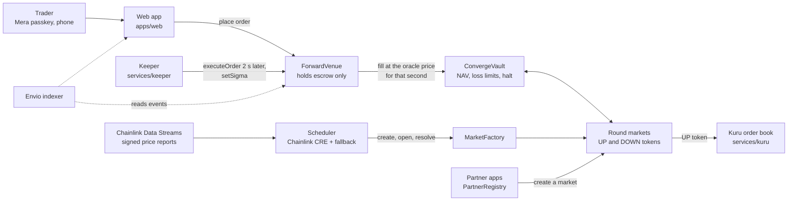

# Converge Markets

**An onchain liquidity vault and 15-minute UP/DOWN markets on Monad. Liquidity providers deposit once; the vault makes a two-sided market in every round; traders bet from a phone with a passkey and no seed phrase.**

Built for the Monad "Metropolis" hackathon (Track 01, Onchain Finance and Trading) and four bounties: Kuru, Chainlink CRE, Mera and Envio. Everything here runs on **Monad testnet with test money**. It is not deployed on mainnet and has not been externally audited (see [Security status](#security-status)).

| | |
|---|---|
| Public app | https://converge-markets-app.vercel.app (testnet; blocked in some regions by design; the deployed build is older than `main`) |
| Live numbers | https://converge-markets-app.vercel.app/stats, or `/stats` on any run of the app |
| Sponsor-by-sponsor proof | [docs/sponsors/README.md](docs/sponsors/README.md) |
| Submission answers | [docs/submission.md](docs/submission.md) |
| Every number, with its source | [docs/numbers.md](docs/numbers.md) |

## The problem

A prediction market with no liquidity is useless: the first bet either cannot be placed or pushes the price to an extreme. Short rounds make it worse, because every 15-minute round starts empty again. Our thesis is that this is what stalled earlier Monad betting apps (unverified: see the note below).

> Source needed: Kizzy's public post-mortem on empty pools. Web searches on 2026-10-10 found coverage of Kizzy but not that post-mortem, so no link is cited here. Nisarg to add the link; see the open item in [docs/numbers.md](docs/numbers.md) (N0).

## The solution

Converge separates the two jobs. **Liquidity providers** put USDC into one vault ([`ConvergeVault`](contracts/src/vault/ConvergeVault.sol)). The vault prices every round from a fair-value model (a digital option, `P(UP) = N(d2)`) and quotes both sides, inside hard loss limits: **1 % of the vault per market and 8 % in total**, enforced on chain ([live values](docs/evidence/phase-10/live-params.md)). **Traders** place an order from a phone; it is filled **two seconds later at the oracle's price for that second**, so nobody trades against a price they could already see move ([ADR-004](docs/adr/ADR-004-forward-priced-execution.md)).

We backtested our first design and **it lost money**. Keeper-posted quotes were beaten by faster traders: **-$88/day** on the 30-day hold-out against a bot with a one-second information lead. Forward-priced execution fixes that for leads shorter than the delay (**+$49.6/day** under pessimistic flow on a $5,000 vault), but it is not robust to longer leads (**-$145.3/day at a 3 s lead**). The honest read is in [backtest/report/REPORT.md](backtest/report/REPORT.md).

What a person sees ([`apps/web`](apps/web)): sign in with Face ID (a Mera passkey is the whole account), tap Up or Down, confirm once, collect when the round ends. Rounds are meant to be created, opened and resolved by a Chainlink CRE workflow with a fallback keeper ([`services/scheduler`](services/scheduler)): the workflow is **simulated against live testnet but not deployed** (it needs CRE Early Access), so a TypeScript scheduler runs the testnet rounds. A round's UP token can be listed on Kuru's order book ([`services/kuru`](services/kuru)): that has been run for two live testnet rounds. An Envio indexer ([`indexer`](indexer)) serves history; it runs locally and its hosted deployment is in progress.

## Not a new format

Polymarket already runs 15-minute Bitcoin Up/Down markets (its US app launched them on 2026-09-22, settled with Chainlink's BTC/USD oracle: [Crypto Briefing](https://cryptobriefing.com/polymarket-15-minute-bitcoin-markets-us/); coverage we could not open reports similar crypto markets on its main platform since October 2025). We do not claim the format is new. What we are building is the liquidity layer behind it: one pooled vault that a third-party app can plug into with one SDK call, on a chain where upkeep costs a fraction of a cent. We have no users and Polymarket has real volume. Whether a pooled vault beats a book of professional market makers is the open question that traction would answer.

## Why Monad

Keeping an onchain market maker current has to be cheap or it does not exist. We measured what ours costs on Monad testnet and priced the same gas on Ethereum mainnet at live prices.

| What the keeper pays | Gas limit | Monad (measured gas, live price) | Ethereum mainnet (estimate, live price) |
|---|---:|---:|---:|
| Refresh the volatility the ladder uses (`setSigma`) | 53,076 | **$0.000136** | $0.0077 |
| Serve one trade (`executeOrder`) | 664,935 | **$0.0017** | $0.0965 |
| One Kuru cancel-and-replace two-sided quote | 554,734 | **$0.0014** | $0.0805 |
| One 15-minute round of upkeep | 1,094,505 | **$0.0028** | $0.1588 |
| One series-day (96 rounds) | 105,072,480 | **$0.27** | $15.24 |

About **57 times cheaper** at today's prices. **Method** (full inputs in [docs/evidence/phase-10/cost-comparison.md](docs/evidence/phase-10/cost-comparison.md), rerun with `node scripts/numbers/cost-comparison.mjs`):

1. **Monad is measured.** Monad bills the gas *limit*; the keeper sends estimate + 15 %. Cost = gas limit x gas price (**102 gwei**, `eth_gasPrice` on Monad mainnet, 2026-10-10) x MON/USD (**$0.02503**, Chainlink on Monad mainnet, same day). The gas numbers are the 53 keeper transactions in [docs/evidence/phase-5/costs.md](docs/evidence/phase-5/costs.md).
2. **Ethereum is an estimate.** The same operations use the same gas, but Ethereum bills gas *used* = limit / 1.15. Cost = (limit / 1.15) x **0.0669 gwei** (`eth_gasPrice`, 2026-10-10) x ETH/USD (**$2,493.5**, Coinbase). It prices the same bytecode work; it does not model Ethereum state-access pricing, and Kuru itself only exists on Monad.
3. **We compared against Ethereum mainnet only.** Layer-2s (Base, Arbitrum and others) are far cheaper than Ethereum mainnet and we did not measure them, so this table does not show Monad cheaper than an L2. **Ethereum's gas price today is unusually low.** At 1 gwei or 10 gwei (scenarios, not data) a series-day is $228 or $2,278 instead of $15.24. The ratio is the point only if you also state the gas price, so the table states it.

Monad's block time, measured over 200,000 blocks, is **0.302 s** on both testnet and mainnet ([docs/evidence/phase-10/chain-facts.md](docs/evidence/phase-10/chain-facts.md)).

## Architecture



## Live links (Monad testnet, chain 10143)

| Contract | Address |
|---|---|
| Vault | [`0x5dD05FfD80f8959aBD25c82A57f5BD106C27B082`](https://testnet.monadvision.com/address/0x5dD05FfD80f8959aBD25c82A57f5BD106C27B082) |
| Venue | [`0xb23836FCE92EF669eBEF742f685eC960FF7630D9`](https://testnet.monadvision.com/address/0xb23836FCE92EF669eBEF742f685eC960FF7630D9) |
| Market factory | [`0x6d3C829CbE58c53625b714d19E49cE1D41e66639`](https://testnet.monadvision.com/address/0x6d3C829CbE58c53625b714d19E49cE1D41e66639) |
| Data Streams resolver | [`0x0B1122271A5103193E17A31543De274474a4f10D`](https://testnet.monadvision.com/address/0x0B1122271A5103193E17A31543De274474a4f10D) |
| Scheduler receiver (CRE) | [`0x92e749013cd31a43EBd41FfEe96Ce95E58008322`](https://testnet.monadvision.com/address/0x92e749013cd31a43EBd41FfEe96Ce95E58008322) |
| Partner registry | [`0xB50b2Ce17704A15642743F528f91bF7EeD02129E`](https://testnet.monadvision.com/address/0xB50b2Ce17704A15642743F528f91bF7EeD02129E) |
| Test USDC (open mint) | [`0x9dedC1B054a0e53777df49722D1Aa20354edB100`](https://testnet.monadvision.com/address/0x9dedC1B054a0e53777df49722D1Aa20354edB100) |

All addresses: [`deployments/testnet.json`](deployments/testnet.json). The testnet oracle is a mock verifier with a test signer, so whoever holds that key decides testnet prices; mainnet uses real Data Streams reports.

## Run it locally

Needs Node 22.13 or newer, pnpm 11, and [Foundry](https://getfoundry.sh) (`forge` and `anvil`).

```bash
git clone https://github.com/nisargpatel7042lva/converge-markets.git
cd converge-markets
pnpm install --frozen-lockfile
(cd contracts && forge build)   # compiles the contracts the demo deploys (about 20 seconds)
make check-docs-10      # about 10 seconds: demo script timing, launch-thread length, the numbers ledger, every link and transaction
.demo/start.sh          # a local chain, the real contracts, a funded vault, the keeper, a scheduler, the app
# open http://localhost:3100 in a phone-sized window; stop with .demo/stop.sh
```

If you run `make check-all` before the demo, run `(cd contracts && forge build)` again afterwards: Slither rebuilds the artifacts without the test helpers the demo and the end-to-end tests deploy.

The demo runs on a local chain with test money, so you can create an account with a passkey, add test money, place a bet, watch the keeper fill it two seconds later and collect after the round. Details: [docs/ops/local-demo.md](docs/ops/local-demo.md). The full suite (`make check-all`, which needs Slither, then `make check-10`, plus the 25-minute `make check-9` with mainnet-fork and invariant runs) is described in [docs/phases/PHASE-9-report.md](docs/phases/PHASE-9-report.md).

## Security status

- **Internally reviewed, not externally audited.** A first review plus the invariant runs found 18 issues and a second review found 22 more; every one is fixed or accepted with a written reason ([docs/security/internal-audit.md](docs/security/internal-audit.md)). 412 contract tests pass, plus three invariant suites at 10,000 runs x depth 100; the invariant runs found a real solvency bug that neither review found, now fixed.
- **One HIGH stays open:** the Chainlink Data Streams path has never run on a real report, because we have no Data Streams credentials. A gate (`check-streams`) blocks launch until it has.
- **Capped beta by design.** The launch cap is 5,000 USDC; users can always exit (pausing never blocks redeem or withdrawal); the contracts are built so ownership sits behind a timelock and a Safe on mainnet (not deployed yet).
- **Not deployed on mainnet.** That needs a funded deployer, a Safe, Data Streams credentials and an audit decision, none of which exist yet ([launch checklist](docs/ops/launch-checklist.md)).

## Team

**Nisarg Patel** ([@nisargpatel7042lva](https://github.com/nisargpatel7042lva)), builder.

## Map of the repo

`contracts/` Foundry contracts. `packages/strategy/` pricing and quoting math shared by backtest and keeper. `packages/sdk/` TypeScript SDK. `services/keeper/` the market-maker keeper. `services/scheduler/` the CRE workflow and fallback. `services/kuru/` the Kuru lister. `indexer/` Envio HyperIndex. `apps/web/` the Mera-powered app. `backtest/` the harness and report. `docs/` decisions (ADRs), phase reports, evidence, ops. Status of every phase: [docs/STATUS.md](docs/STATUS.md).
